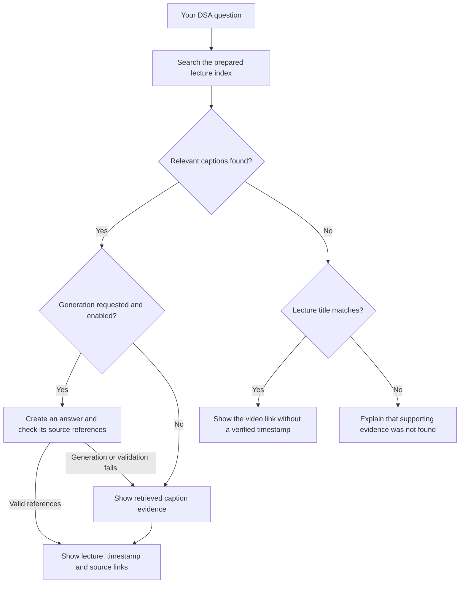

# A2Z Studyroom

**Find the lecture. Jump to the timestamp. Revise the topic.**

### [Open the live demo →](https://a2z-studyroom.onrender.com/)

[Student guide](docs/USER_GUIDE.md) · [Run locally](#start-locally-without-keys) · [Deployment](docs/DEPLOYMENT.md) · [Prepared lecture bundle](https://github.com/alisalmann7386-crypto/a2z-studyroom/releases/download/a2z-data-v1/A2Z_314_Lectures.zip)

> “Yeh topic padha toh tha… par kaunse lecture mein?”

A2Z Studyroom helps you search [Striver’s A2Z DSA playlist](https://www.youtube.com/playlist?list=PLgUwDviBIf0oF6QL8m22w1hIDC1vJ_BHz), find the relevant explanation, and revise it with linked lecture sources.

## Why I built it

While solving DSA problems, I sometimes wanted to revisit an explanation I had already watched. I remembered the topic, but finding the right video and the right part of a long lecture took time.

That became the idea behind A2Z Studyroom: ask a question in your own words, find where the topic is taught, and continue studying from there.

**Example:** ask **“Where is partition equal subset sum taught?”** The app looks for relevant lecture captions and shows the lecture, its playlist position, and a timestamp when caption evidence is available.

## Try the website in a minute

1. Open the **[live demo](https://a2z-studyroom.onrender.com/)**.
2. Choose **Find lecture** and ask **“Where is binary search taught?”**
3. Open the **Best match**, inspect its caption excerpt, or use **Watch** to jump into the lecture.
4. Choose **Quick revision** and ask **“Summarise it.”**
5. Use **Save notes** to keep the notes, then **Quiz me / Practice** to test your recall.

Choose **English**, **Hinglish**, or **Hindi** in the answer-language menu. Generated explanations and translations depend on the server’s model configuration; the caption search can work without an LLM.

> Topic yaad hai, video yaad nahi? Topic poochho, source kholo, aur wahi se revise karo.

## What a result tells you

| On the screen | What it means |
|---|---|
| **Playlist #196** | The video’s position in the A2Z playlist |
| **DP 15** | The creator’s series label; it is a different numbering system |
| **Caption timestamp** | The matching moment in an indexed lecture transcript |
| **Watch / YouTube link** | Opens playback near that moment, sometimes a few seconds earlier for context |
| **Short recap or explanation** | Retrieved source text, a clearly labeled title overview, or a generated answer |
| **Source buttons such as [1]** | Open the supporting caption excerpt so you can check the answer |

This example numbering illustrates how to read a result. Related lectures may also appear; start with **Best match** and check the source.

## Pick the tool you need

| Tool | When to use it | Example question |
|---|---|---|
| **Find lecture** | Locate a topic and its available timestamp | Where is binary search taught? |
| **Explain** | Understand an idea with an example | Explain binary search with a small example. |
| **Quick revision** | Create structured study notes | Create revision notes for partition equal subset sum. |
| **Hint only** | Get a nudge before trying the problem yourself | Binary search. |
| **Compare** | Study two approaches together | Compare iterative and recursive binary search. |
| **Complexity** | Ask about supported time and space costs | What are the time and space costs of binary search? |
| **Code** | Request an implementation from the retrieved evidence | Binary search. Keep the implementation short. |

**Code** supports Python, C++, and Java. **Quick revision** offers **Concise notes** and **Exam-ready notes**. Explain, notes, hints, comparisons, complexity explanations, and derived code require a configured model for generated output; otherwise the app shows available source evidence.

## How it works, simply

**RAG** means *retrieval-augmented generation*: find relevant lecture passages first, then use them to support an answer. The default search uses **BM25**, which ranks matching text in a prepared **SQLite** index.



Caption text and timestamps are prepared ahead of time. **Students do not download videos or rebuild the index when asking questions.** Playing a linked lecture still uses YouTube.

If generation fails or its references are invalid, the app returns the retrieved evidence with a message. Source checks reduce unsupported output; they do not prove every explanation or code example is correct.

## Keep studying after the first answer

- **Follow up:** “Summarise it”, “Explain step 3”, or “Show the recursive version”. The app uses the recent topic and selected lecture where it can resolve the reference.
- **Save notes:** use **My notes** for categories, annotations, downloads, and lecture references.
- **Practise:** write an attempt before revealing a recall card, then rate it to schedule another review.
- **Track progress:** bookmark lectures or mark them **Completed** / **Revise again**.
- **Keep a backup:** export and import study data through **Settings → Study backup**.

Follow-up context is limited, so name the topic again when a question is ambiguous. Notes and progress stay in the current browser. Optional conversation history is off by default, and there is no automatic account sync.

**[Read the student guide →](docs/USER_GUIDE.md)** for a complete example, source reading, practice, backup, and common questions.

## Lecture coverage

| Prepared-data checkpoint | Count |
|---|---:|
| Accessible videos in the verified catalog | 315 |
| Lectures with indexed captions | 314 |
| Timed transcript windows | 6,933 |
| Caption coverage | 99.7% |

These are the **16 October 2026 checkpoint** figures, not a live counter. Playlist **#113, Ceil in BST**, has a searchable video link but no indexed captions in that bundle. See [the coverage report](docs/LECTURE_COVERAGE.json), [current server statistics](https://a2z-studyroom.onrender.com/api/stats), or [download the prepared bundle](https://github.com/alisalmann7386-crypto/a2z-studyroom/releases/download/a2z-data-v1/A2Z_314_Lectures.zip).

The repository includes metadata and original sample notes. The prepared transcript index is distributed separately. Starting without that index opens the sample-notes demo, not the complete lecture corpus.

## Build and run it yourself

The expandable section below keeps the complete setup, ingestion, deployment, API, and validation reference. Start with **[local setup](#start-locally-without-keys)**, **[training/indexing](docs/TRAINING.md)**, or **[deployment](docs/DEPLOYMENT.md)**.

<details>
<summary><strong>Open developer setup and detailed technical reference</strong></summary>

A deployable study application for [Striver’s A2Z DSA playlist](https://www.youtube.com/playlist?list=PLgUwDviBIf0oF6QL8m22w1hIDC1vJ_BHz). Ask a question, retrieve transcript segments, and open the lecture near the explanation. Generated answers are optional; retrieval works without an LLM key.

**What students get:** ask “Where is binary search taught?” or “Revise distinct subsequences” to see the video title, playlist position, the creator's series label (for example `DP 32`), a timestamp link, and a short recap from indexed captions. When captions have no complete sentence boundaries, the fallback is explicitly labeled as a title-based lecture overview, with the original passage available separately. Optional LLM explanations add examples, hints and code.

**Data included in GitHub:** a verified catalog of **315 accessible A2Z videos** (16 October 2026 UTC), plus 22 original DSA revision notes. One unavailable/untitled playlist entry was excluded. The catalog provides genuine lecture links immediately; timestamps and lecture summaries require a prepared caption index. Raw lecture transcripts, API keys and runtime databases are not committed. Coverage is visible in the website and `/api/stats`; no title-only result is presented as a verified timestamp.

**Prepared data checkpoint:** **314/315 lectures (99.7%)**, with **6,933 timed windows**, are saved in the separately supplied `A2Z_314_Lectures.zip`. Only playlist #113, *Ceil in BST*, remains without captions: YouTube reports disabled transcripts and the audio response is an HTML error page. Its real video link is still searchable. See [the coverage report](docs/LECTURE_COVERAGE.json).

## Features

- Caption-level timestamp links, playlist positions, series labels, concise extractive summaries, and an embedded YouTube player.
- Find lecture and Quick revision modes; title-search fallback for missing captions.
- Professional dark workspace with mint, violet, amber, and blue accents, responsive lecture library, source explorer, embedded playback, and useful keyboard shortcuts.
- Full playlist browser, topic shortcuts, caption availability filters, coverage details, saved lectures on your device, and chat exports including source links.
- Stop-response control, caption excerpts, timestamp-link copying, and source navigation that restores the correct evidence for earlier answers.
- Per-lecture retrieval filters; English, Hinglish, and Hindi response choices.
- Explain, hint, compare, complexity, and code modes with a configured LLM.
- Captions-first offline ingestion, cached resume, optional Whisper, JSON/SRT/VTT imports.
- BM25 + SQLite without model downloads; optional semantic embeddings and Qdrant.
- Responsive UI and API on one FastAPI server, network binding, Docker and Render setup.
- No-evidence refusal, citation validation, provider failure fallback, optional shared access key.
- Follow-up topic continuity based on user questions, exact playlist-number search (`37`, `Lecture 37`, `#37`) and separate series-label search (`DP 15`).
- Bold lecture/timestamp labels, direct watch links below answers, best-match versus related-source labels, safe Markdown tables and copyable code blocks.
- Completed/revise-again markers, progress filters and a Continue studying card that reopens the last selected caption timestamp.
- Optional conversation history: enable **Settings → Remember conversations** to restore questions, answers, citations and mode/language choices on the same device. History is off by default; up to eight conversations (40 turns each) are retained. Clear history in the History dialog. Bookmarks and revision progress are stored locally regardless; there is no cross-device account sync. No API key is stored with chats.
- Quick Revision creates six sections: topic/goal, intuition, steps/recurrence, a worked illustration, time/space complexity, and implementation cautions plus recall questions with answers. Choose **Concise notes** or **Exam-ready notes**. Notes sample distinct teaching sections from the best matching lecture, including its later complexity discussion, and retain clickable source references. Copy/download a single set of notes as Markdown with lecture links.
- Use **Make revision notes**, **Time & space**, **Explain a step** or **Show code** below an answer to study that answer's lecture, including older answers. The visible lecture filter shows the selected scope.
- Click the **S avatar** at the bottom of the library to open your learner profile. Set a display name and study goal, and see completed/revise-again/bookmark counts. The profile is stored in the current browser; it does not create an online account.
- **My notes** saves up to 40 sets of revision notes independently of chats, with topic categories, searchable personal annotations, per-note downloads and original lecture references.
- **Quiz me / Practice** turns the six cited note sections into recall cards. Type an attempt, reveal the answer, then choose **Revise again** (10 minutes) or **Got it** (1, 3, 7, 14, then 30 days). The due queue and weak-topic view use your own ratings; this is not automatic assessment. Up to 160 cards are kept locally. Without a model, reading/recall cards show original caption passages explicitly.
- Follow-ups such as **Explain step 3**, **Why iterate backwards?** and **Show the recursive version** retain the previous topic and lecture. Prior generated text is only conversation context for identifying a step, never retrieval evidence. Named new topics and exact lecture references can switch context.
- **Settings → Study backup** exports/imports notes, annotations, cards, profile, bookmarks and progress as JSON. Import validates and merges data; existing note IDs are preserved. Chats and access keys are excluded. This provides manual device transfer; automatic account sync requires a separate authentication/database service and is not configured.
- Validated generated revision notes are cached server-side for seven days (128 entries maximum). The key includes the full resolved request, language/detail, model, source contents and cache version. Failed generation, source extracts and title-only results are never cached as generated notes. On ephemeral hosting, this cache can reset on deploy/restart; no reindex is required.
- Curated typo/Hinglish/Hindi query aliases and combining-mark-aware tokenisation improve common search variants without silently rewriting arbitrary unknown words.

The complete retrieval workflow can be checked without any LLM calls:

```bash
python -m pytest -q
node --test tests/ui_interactions.cjs
python -m app.cli eval --file tests/fixtures/study_queries.json --pipeline
python -m app.cli eval --file data/eval_lectures.json
```

The 48-case workflow fixture checks primary lecture selection, follow-ups, typos, bilingual queries, unsupported topics and missing captions. The separate 18-case fixture checks raw passage retrieval, including six time windows. These are regression samples, not comprehensive accuracy estimates. BM25 is still the deployed default. Hybrid search requires the optional semantic dependencies and a matching rebuilt index; run the same fixtures on both backends before changing production. This update does not claim a measured hybrid-search improvement.

Independent application, not affiliated with Striver or takeUforward. References identify retrieved evidence; a syntactically valid citation does not prove every generated claim. Verify important answers against the source.

## Start locally without keys

Python 3.11–3.12 recommended; Python 3.12 used for validation.

```bash
git clone https://github.com/alisalmann7386-crypto/a2z-studyroom.git
cd a2z-studyroom
python -m venv .venv
# Windows PowerShell: .venv\Scripts\Activate.ps1
# macOS/Linux: source .venv/bin/activate
python -m pip install -e ".[dev,ingest]"
```

Copy `.env.example` to `.env` (`Copy-Item .env.example .env` in PowerShell, or `cp .env.example .env` on macOS/Linux), then:

```bash
python -m app.cli serve --host 0.0.0.0 --port 8000
```

If a prepared index is present, it is used immediately. Otherwise, the server creates the original-notes demo. To load the supplied lecture bundle before starting:

```bash
python -m zipfile -e /path/to/A2Z_314_Lectures.zip data
python -m app.cli serve --host 0.0.0.0 --port 8000
```

Do not run `index --demo` over a prepared lecture index; that command deliberately replaces it with sample notes.

Open **http://localhost:8000**. API documentation: **http://localhost:8000/docs**. Other devices on the same Wi-Fi use **http://YOUR_LAPTOP_LAN_IP:8000** after you allow inbound TCP 8000. `0.0.0.0` is the bind address, not a browser address; it does not automatically create public internet access.

## Prepare the real playlist (“training”)

RAG uses pretrained models. You build its knowledge index rather than training an LLM from scratch.

```bash
python -m app.cli preflight
python -m app.cli ingest --start-position 8 --limit 3
python -m app.cli index
python -m app.cli search "recursion base case"
```

Inspect `data/transcripts/` and `data/ingest_report.json`. When the pilot works:

```bash
python -m app.cli ingest --workers 1 --delay-seconds 5
python -m app.cli index
python -m app.cli stats
```

Ingestion caches timestamped text; indexing creates the query snapshot. Real indexing replaces the demo corpus. The running server notices a rebuilt index on the next request. Rerunning ingestion skips valid cached work. A blocked or partial run records failures and exits nonzero. Run again to resume transient failures; known IP blocks stop new requests. Use `--start-position` / `--end-position` to prepare particular sections. Refresh title metadata alone with `python -m app.cli catalog`.

**Your users do not download any videos.** Available captions are fetched once as text by the administrator. Only optional offline Whisper preparation downloads audio for missing captions. Deployed retrieval reads the prepared index and is tested with YouTube/network access blocked; playing the linked video still requires YouTube access.

Read **[docs/TRAINING.md](docs/TRAINING.md)** for the complete setup, semantic embeddings, missing captions, Colab, and evaluation.

## Move a prepared index to another machine

```bash
python -m app.cli export --output a2z_index.zip
# Add --include-transcripts to preserve caption caches for future resume/reindex.
```

Extract `index.sqlite3` into the target `data/` directory and start the server. The archive includes its SHA256 checksum and coverage report. The snapshot also contains playlist order, so no playlist scrape is needed at query time. See the deployment guide for HTTPS index transfer on Render.

## Verify changes

```bash
python -m pytest -q
# Optional frontend development checks; Node 20+ only for these checks:
npm ci
npm run test:ui
# With the prepared lecture index:
python -m app.cli eval --file data/eval_lectures.json
```

The frontend remains buildless; Node is not required to serve the website. DOM interaction tests exercise controls and rendering logic, while actual browser layout remains a separate check. Validation details are in [docs/VALIDATION.md](docs/VALIDATION.md).

## Enable generated explanations

In server `.env` or hosting secrets:

```dotenv
LLM_PROVIDER=groq
GROQ_API_KEY=your_key_here
LLM_MODEL=openai/gpt-oss-20b
```

Restart after changing environment values. Keys remain on the server. Missing keys, provider errors, and invalid citations fall back to retrieved excerpts. A no-evidence refusal makes no LLM call. Provider costs and quotas depend on your account.

For Groq `openai/gpt-oss-20b` / `openai/gpt-oss-120b`, the app requests a strict JSON answer with source IDs drawn only from the retrieved excerpts. It renders the citation markers itself, validates every answer block, and ignores provider reasoning metadata. Other models retain the free-form citation validator. Truncated or invalid responses still fall back to evidence; a configured provider in `/api/stats` alone does not prove that generation succeeded. Use **Explain** and check for **Generated explanation** below the answer; **Find lecture** intentionally returns extractive locations.

For explicit complexity questions, generation also includes available complexity sections from the top matching lecture. Literal equal-partition examples are checked for totals and element multiplicities, and requested complexity must be addressed. A detected inconsistency permits one correction attempt; persistent failures return evidence instead. These scoped checks do not prove arbitrary mathematical claims or code correctness.

## Retrieval choices

| Setup | Requirements | Suitable for |
|---|---|---|
| BM25 + SQLite | Base installation, no GPU | Low-memory deployments and first launch |
| BM25 + local dense vectors | `.[semantic]`, pretrained MiniLM | Better paraphrase retrieval |
| BM25 + Qdrant | Same embedder, Qdrant HTTPS | Managed vector storage |

```bash
python -m pip install -e ".[semantic]"
python -m app.cli index --semantic
```

Set `RETRIEVAL_BACKEND=hybrid`. Index and queries must use the same `EMBEDDING_MODEL`. To use Qdrant, set its URL/key and run `python -m app.cli index --semantic --qdrant`. Qdrant is optional; it does not remove the query embedding model's memory requirement or the local evidence corpus.

## Deploy

```bash
# Create .env first and prepare the index locally.
docker compose up --build -d
```

The container binds to `0.0.0.0:8000` and mounts `./data`. The server reads a prepared index; students do not transcribe lectures. See **[docs/DEPLOYMENT.md](docs/DEPLOYMENT.md)** for Render, Railway, disk/index transfer, optional access control, and network setup. The included `render.yaml` launches the notes demo until you supply a real index.

## API

| Route | Purpose |
|---|---|
| `GET /health` | Process health and corpus readiness |
| `GET /api/stats` | Corpus size and configuration |
| `GET /api/videos` | Indexed library |
| `POST /api/locate` | Search the verified lecture catalog by title |
| `POST /api/search` | Retrieval only |
| `POST /api/ask` | Answer with source references |

```bash
curl -X POST http://localhost:8000/api/ask \
  -H "Content-Type: application/json" \
  -d '{"question":"memoization vs tabulation", "mode":"compare", "language":"English"}'
```

If `APP_API_KEY` is set, add `X-API-Key` or enter it in UI settings. Default UI/API traffic is same-origin. SQLite rate limiting covers search and ask across workers sharing one disk. Separate replicas need a shared limiter.

For a short follow-up, send the prior user topic as `context_question` (maximum 1,200 characters), or the last six turns as `history`. These fields guide topic resolution only, never count as lecture evidence. Explicitly naming a new topic overrides the previous topic. This lightweight heuristic is not unlimited conversation memory; select a lecture or name the topic again when a follow-up is ambiguous.

Complexity and Code modes now supplement a direct lecture match with its explicit complexity sections where available. Without a model key, every mode remains evidence-only: translations, derived code and generated explanations are not promised. If a model abstains despite matching captions, those passages remain visible with a warning instead of disappearing behind a generic refusal.

Quick Revision accepts `"mode":"summary"` and `"revision_detail":"quick"` or `"detailed"` (the default). For example, ask `Create revision notes for partition equal subset sum`, then `Summarise it` in the same conversation. A configured model produces cited study notes; unavailable or invalid generation returns multiple original lecture excerpts labeled as such. Missing captions remain a title-only result. Details absent from the selected excerpts are explicitly marked as unestablished. The notes do not claim exhaustive lecture coverage.

## Source layout and checks

`app/main.py` serves FastAPI; `ingest.py` prepares transcripts; `chunking.py` preserves timestamps; `retrieval.py` ranks evidence; `answer.py` handles prompting and citations; `cli.py` builds/evaluates indexes; `store.py` writes atomic snapshots; `bootstrap.py` prepares remote indexes; `catalog.py` handles metadata-only lecture discovery; `static/` contains the UI. Runtime data and `.env` are ignored by Git.

```bash
python -m pytest -q
python -m app.cli eval --file data/eval.json
# With actual prepared captions, use the live regression targets:
python -m app.cli eval --file data/eval_lectures.json
```

The bundled evaluation set is for demo notes. Replace expected titles with real video IDs and timestamp ranges after playlist ingestion.

## Reference analysis

Designed after reviewing [week3/ytscraper in padho_with_pratyush_Ai_Enginner](https://github.com/perryvegehan/padho_with_pratyush_Ai_Enginner/tree/main/week3/ytscraper). This is a fresh implementation of its timestamp-aware lecture RAG workflow. Reference source and transcripts were not copied. Read **[docs/REFERENCE_ANALYSIS.md](docs/REFERENCE_ANALYSIS.md)**.

</details>
