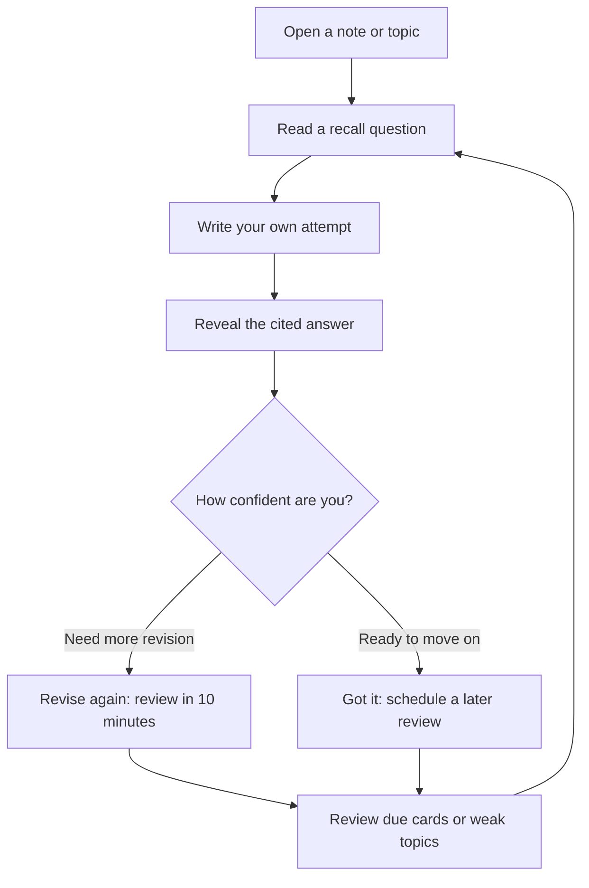

# A2Z Studyroom — student guide

**[Open the live demo](https://a2z-studyroom.onrender.com/)** · **[Back to the README](../README.md)**

> Pehle lecture dhoondho, phir samjho, aur apne words mein revise karo.

This guide follows one topic from lecture search to saved notes and practice. You can use the same steps for other topics covered by the indexed A2Z lectures.

## 1. Find the explanation you remember

1. Select **Find lecture** in the study-mode menu.
2. Ask **“Where is binary search taught?”**
3. Start with **Best match**. Other results may cover related problems.
4. Open a source button or **Read full caption excerpt** to check the passage.
5. Use **Watch** or **YouTube** to play the relevant moment.

You can also browse the lecture library, use topic shortcuts, or select a specific lecture to narrow the search.

### Read the labels correctly

| Label | Meaning |
|---|---|
| **Playlist #45** | Position in the overall A2Z playlist |
| **BS 1** | The binary-search series label from the video title |
| **Caption match** | Where the matching caption begins |
| **Watch from** | Playback position; it may begin a few seconds earlier for context |
| **Related lecture** | Another useful match, not necessarily the main explanation |

Playlist numbers and series numbers are different. A search for **Lecture 37** refers to playlist position; **DP 15** refers to a series label.

A result labeled **Title matches only** can link to a genuine lecture, but cannot verify an in-video timestamp or summary from captions. If no supporting source is found, try a clearer topic or a different lecture.

## 2. Ask for the kind of help you need

Choose the mode first, then ask your question.

| You want to… | Choose | Try asking… |
|---|---|---|
| Understand the idea | **Explain** | Explain binary search with a small example. |
| Revise the topic | **Quick revision** | Create revision notes for binary search. |
| Try before seeing a solution | **Hint only** | Binary search. |
| Compare approaches | **Compare** | Compare iterative and recursive binary search. |
| Check resource costs | **Complexity** | Explain binary search time and auxiliary space. |
| See an implementation | **Code** | Binary search. Keep the implementation short. |

For **Code**, select **Python**, **C++**, or **Java**. Generated implementations should be checked against the lecture and tested for your problem’s constraints.

The answer-language menu offers **English**, **Hinglish**, and **Hindi**. Generated notes, translations and explanations need a model configured by the server owner. You do not enter the owner’s provider API key into the public website.

Without a working model, the app can still return original source passages. A passage is useful evidence, but is not the same as a newly written explanation or translation.

## 3. Continue with a follow-up

After finding or discussing a topic, stay in the same conversation and try:

- **“Summarise it.”**
- **“Explain step 3.”**
- **“Show the recursive version.”**

The app uses recent user questions to identify the topic. It can keep a previous lecture in scope for a short follow-up. A named new topic or explicit lecture reference can switch that context.

> “Iska summary do” jaisa follow-up tab useful hai jab topic pehle se clear ho. Confusion ho toh topic ka naam dobara likho.

This is limited topic continuity, not unlimited memory. Check the visible lecture filter. If the answer is about the wrong lecture, change the filter or ask with the full topic name.

Buttons such as **Make revision notes**, **Time & space**, **Explain a step**, and **Show code** reuse the lecture associated with that answer. They are useful when returning to an earlier answer in a conversation.

## 4. Make notes you can return to

1. Choose **Quick revision** or **Make revision notes** below an answer.
2. Select **Concise notes** for a shorter recap or **Exam-ready notes** for more detail.
3. Read the six sections:
   - Topic and goal.
   - Core idea or intuition.
   - Steps or recurrence.
   - Worked illustration.
   - Time and auxiliary space.
   - Pitfalls and recall questions.
4. Use the source buttons to check the lecture evidence.
5. Click **Save notes**.

Open **My notes** to find saved notes, filter by category, add personal annotations, copy the text, or download a note with its lecture references.

The notes use selected lecture excerpts. They do not promise to cover every minute of a lecture. If a detail is absent from the retrieved passages, the answer should say so. Without generated notes, Quick revision shows original lecture passages with their sources.

## 5. Practise before revealing the answer

Use **Quiz me**, **Practice**, or **Practice** inside a saved note.

The generated-notes path turns the six cited sections into recall cards. The evidence-only path uses original caption passages as clearly labeled reading/recall cards.

**Revise again** schedules another review in 10 minutes. **Got it** uses later intervals of 1, 3, 7, 14, then 30 days. Due-card and weak-topic views follow your own ratings.

This is self-assessment. The app does not automatically grade your typed answer or certify that it is correct.

## 6. Keep your study workspace

| Control | What you can do |
|---|---|
| **Saved** | Return to bookmarked lectures |
| **Completed / Revise again** | Track lectures and filter your library |
| **Continue studying** | Reopen your last selected lecture moment |
| **S avatar** | Set a display name and study goal; view local study counts |
| **My notes** | Keep notes independently of chat history |
| **Settings → Remember conversations** | Optionally restore conversations on this device |
| **Settings → Study backup** | Export/import notes, annotations, cards, profile, bookmarks and progress |

The S avatar opens a local learner profile. It is not an online sign-in account.

History is **off by default**. Enabling it stores up to eight conversations of 40 turns each in this browser. Saved notes, bookmarks and revision progress are stored locally independently of that setting.

Clearing browser data or switching browsers can remove access to local study data. Use **Study backup** to move supported study data to another device. Backups exclude chats and access keys; automatic cloud sync is not configured.

## Common questions

### Do I need to download the videos?

No. The server searches an index prepared ahead of time. Watching a linked video still requires YouTube access.

### What is a citation?

A source button such as **[1]** points to a retrieved lecture passage. Open it to inspect the evidence and timestamp. A valid source reference helps you verify an answer; it does not guarantee that every generated statement or code line is correct.

### Why did I get source excerpts rather than an explanation?

The model may be disabled, unavailable, or unable to produce an answer that passes the source checks. The app keeps the retrieved passages visible and explains the fallback.

### Why does a lecture have a video link but no timestamp?

Its title may be in the catalog while its captions are missing. The prepared bundle has captions for 314 of 315 catalog lectures at the 16 October 2026 checkpoint. See [the coverage report](LECTURE_COVERAGE.json).

### Does the app learn from every question?

It uses a prepared retrieval index and limited conversation context. Asking a question does not train a new model or add a lecture to the index.

### Can I use this for any YouTube playlist?

The supplied catalog and prepared bundle target Striver’s A2Z DSA playlist. This demo does not automatically index an arbitrary playlist when a student asks a question.

## For developers

See [local setup in the README](../README.md#start-locally-without-keys), [index preparation](TRAINING.md), [deployment](DEPLOYMENT.md), and [validation notes](VALIDATION.md).

A2Z Studyroom is an independent study application, not affiliated with Striver or takeUforward. Lecture content belongs to its original creator.
